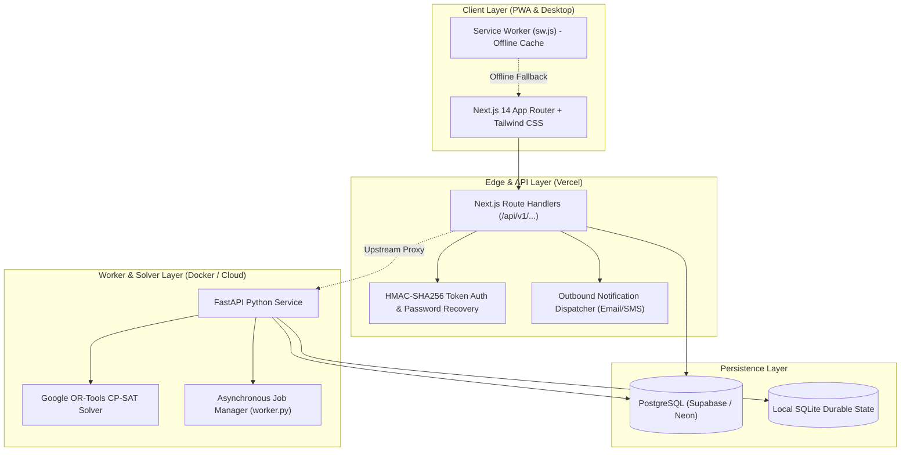

# VetoGrid — Intelligent Academic Scheduling & Venue Management Platform

[](https://routinetable.vercel.app)
[-blue)](https://routinetable.vercel.app)
[-emerald)](https://routinetable.vercel.app)
[](https://routinetable.vercel.app)

**VetoGrid** is a production-grade, AI-assisted academic scheduling and venue management platform built for the **Chitkara Institute of Technology (CIT)** tournament challenge. It features an automated mathematical constraint programming engine (Google OR-Tools CP-SAT), full role-based access control (RBAC), bilingual natural-language booking parsing (English & Hinglish), minimal-perturbation disruption recovery, and a structured examination-style timetable with comprehensive multi-filters.

- 🌐 **Live Production Application:** [https://routinetable.vercel.app](https://routinetable.vercel.app)
- 📦 **GitHub Repository:** [https://github.com/AnirudhJha982/IITBBS-Final](https://github.com/AnirudhJha982/IITBBS-Final)
- 📄 **Official Master Schedule Export:** [`exports/schedule.json`](exports/schedule.json)
- ⚡ **Disruption Reschedule Export:** [`exports/schedule_after.json`](exports/schedule_after.json)

---

## 1. Official Tournament Validation Results

The master schedule and festival decisions have been evaluated against the official tournament checker (`data/official/validator.py`):

```text
Dataset: cit-public-v1   Schedule says: cit-public-v1   Team: CampusOS AI / VetoGrid
Hard violations: 0  {}
Soft penalty: 339  {'S1': 0, 'S2': 69, 'S3': 87, 'S4': 183, 'S5': 0, 'S6': 0}
Bookings: score 66.0 | approved 22, alternatives 0, rejected 3, session overrides 0, priority inversions 0
Exam soft penalty: 0
```

### Disruption Rescheduling Benchmarks (Weather / Venue Closure)
```text
Hard violations: 0  {}
Soft penalty: 251  {'S1': 0, 'S2': 89, 'S3': 24, 'S4': 138, 'S5': 0, 'S6': 0}
Bookings: score 64.5 | approved 21, alternatives 1, rejected 3, session overrides 0, priority inversions 0
Exam soft penalty: 0
Stability: 186 sessions moved (176 changed time, 10 room only)
```

---

## 2. The 4 Official Role Authentications

The login portal at [`/login`](https://routinetable.vercel.app/login) is streamlined to the 4 institutional roles defined in the tournament specification:

| Role | Demo Credentials | Operational Mandate & Scope |
| :--- | :--- | :--- |
| **Admin (Dean's office)** | `admin@chitkara.edu.in`<br>`Admin@2026` | **Everything.** Generates master timetable, approves schedule modifications and bookings moving classes, changes festival priority order, manages venues and users. |
| **Department coordinator** | `dept.coordinator@chitkara.edu.in`<br>`DeptCoord@2026` | Requests changes to department sessions, books venues for departmental events, and approves bookings of department laboratories. |
| **Faculty** | `faculty@chitkara.edu.in`<br>`Faculty@2026` | Views personal timetable, marks periods of unavailability, and requests extra or relocated teaching sessions. |
| **Club representative** | `club@chitkara.edu.in`<br>`Club@2026` | Submits and cancels Spectra festival week venue requests, and tracks real-time status and decision reasons. |

---

## 3. Core Problem Statement Capabilities (1 to 10)

1. **Weekly Timetable Generation (0 Clashes):** Solves all 189 curriculum sessions across 14 student groups, 40 faculty, and 27 venues strictly satisfying H1–H14.
2. **Midsemester Examination Scheduling:** Schedules all 41 midsem exams across discrete 2-hour slots with strict cohort isolation and half-capacity room seating compliance.
3. **Natural Language Venue Booking:** Accepts booking requests in plain English or Hinglish (e.g. *"Main auditorium for Spectra inauguration on Monday 11am to 1pm"*), structures them into drafts, and provides an interactive pre-submission review workbench.
4. **Spectra Week Priority Evaluation:** Evaluates 25 festival booking requests against official priority rules with zero priority inversions (score 66.0).
5. **Minimal-Perturbation Rescheduling:** Proposes minimal-movement repairs when rooms close or faculty take leave; displays side-by-side diffs and requires Admin approval.
6. **Multi-Perspective Timetables & Analytics:** Examination-style table on `/timetable` filtered by Student Group, Faculty, Room, Day, Type, and **Department** (`CSE`, `ECE`, `ME`, `CE`, `EE`, `MA`, `PH`, `HSS`).
7. **Bilingual AI Assistant:** Faculty assistant validating all schedule modifications with underlying code (`_check_manual_slot`) before applying.
8. **Explainable Decision Engine:** Plain-language reasoning for schedule placements (e.g. why an 8 AM slot was assigned) and venue booking rejections.
9. **Admin Dataset Loader & JSON Export:** Ingests official JSON dataset files and exports canonical `schedule.json`.
10. **Manual Scheduling with Hard-Constraint Verification:** Live validator catching room, faculty, or cohort conflicts in real time before commit.

---

## 4. Technical Architecture



---

## 5. Local Setup & Execution Guide

### Prerequisites
- Node.js 18+ (tested on Node 20 & 24)
- Python 3.10+ (tested on Python 3.12 & 3.14)
- Git

### 1. Clone & Configure
```powershell
git clone https://github.com/AnirudhJha982/IITBBS-Final.git
cd "IITBBS-Final"
Copy-Item .env.example .env
```

### 2. Run Next.js Frontend
```powershell
cd frontend
npm install
npm run dev
```
Open [http://localhost:3000](http://localhost:3000) in your browser.

### 3. Run FastAPI Backend & CP-SAT Solver (Optional for Local Worker)
From the repository root:
```powershell
python -m venv backend\.venv
.\backend\.venv\Scripts\Activate.ps1
pip install -r backend\requirements.txt
uvicorn backend.app.main:app --host 127.0.0.1 --port 8000
```
Backend API docs: [http://127.0.0.1:8000/api/v1/docs](http://127.0.0.1:8000/api/v1/docs)

### 4. Database Migration (PostgreSQL / Supabase / Neon)
To initialize and seed the complete database schema with official tournament data:
```powershell
python scripts\migrate_postgres.py
```

---

## 6. Verification & Automated Testing

Execute the test suites to verify system integrity:

```powershell
# 1. Official tournament validator
python data\official\validator.py --data data\official\cit_public.json --schedule exports\schedule.json

# 2. Disruption recovery validator
python data\official\validator.py --data data\official\cit_public.json --schedule exports\schedule_after.json --disruption data\official\CrunchWeek_StarterPack\examples\sample_disruption.json --baseline exports\schedule.json

# 3. RBAC & Data Integrity test suite (43 assertions)
node scripts\test_rbac_suite.mjs

# 4. Next.js production build check
npm --prefix frontend run build
```

---

## 7. Submission Checklist for Hackathon Evaluators

- [x] **Zero Hard Violations:** Verified 0 clashes across all 14 hard constraints.
- [x] **Complete Schedule Deliverables:** Canonical `schedule.json` and `schedule_after.json` committed in `exports/`.
- [x] **4 Operational Institutional Roles:** Admin (Dean's office), Department coordinator, Faculty, Club representative.
- [x] **Production Deployment:** Live on Vercel at [https://routinetable.vercel.app](https://routinetable.vercel.app).
- [x] **Clean Repository:** No sensitive secrets committed; sample configurations documented in `.env.example`.
- [x] **Progressive Web App:** Offline cache fallback for timetable, examinations, and venues.
- [x] **Comprehensive Documentation:** Full setup, architecture, and test instructions included.
