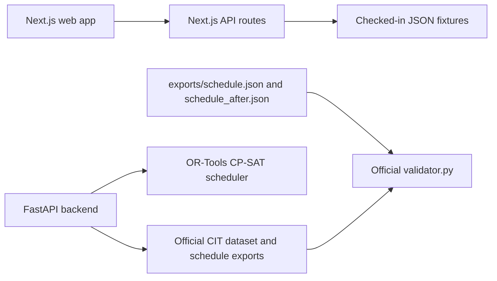

# CampusOS AI

CampusOS AI is a timetable and venue-management prototype for the CIT scheduling challenge. It includes the official CIT dataset, a Google OR-Tools CP-SAT scheduling engine, reference exports, and a Next.js dashboard with demo role accounts.

**Live site:** [routinetable.vercel.app](https://routinetable.vercel.app)

**Repository:** [github.com/AnirudhJha982/IITBBS-Final](https://github.com/AnirudhJha982/IITBBS-Final)

## Architecture



## Technology

- Frontend: Next.js 14, React 18, TypeScript, Tailwind CSS, Recharts, Framer Motion.
- Backend: Python, FastAPI, Pydantic, SQLAlchemy; SQLite locally and PostgreSQL when configured.
- Scheduling: Google OR-Tools CP-SAT and the organizer-provided independent validator.
- Data: official `cit-public-v1` dataset (27 rooms, 40 faculty, 14 groups, 62 courses, 189 sessions, 41 exams, 25 booking requests).

## Run locally (Windows PowerShell)

From the repository root:

```powershell
Copy-Item .env.example .env
python -m venv backend\.venv
.\backend\.venv\Scripts\python.exe -m pip install -r backend\requirements.txt
Set-Location frontend
npm install
npm run dev
```

The web app is at `http://localhost:3000`. In a second terminal, start the API from the repository root:

```powershell
Set-Location "C:\Users\jhaan\OneDrive\Desktop\Projects\Final IIT BBS"
.\backend\.venv\Scripts\python.exe -m uvicorn backend.app.main:app --host 127.0.0.1 --port 8000
```

The API health check is `http://127.0.0.1:8000/api/v1/health`. To run the CP-SAT solver locally, install OR-Tools in the backend environment (`python -m pip install "ortools>=9.11"`).

## Demo accounts

Use the following email/password pairs at `/login`:

| Role | Email | Password |
|---|---|---|
| Admin / Super Admin | `admin@chitkara.edu.in` | `Admin@2026` |
| Department Coordinator | `dept.coordinator@chitkara.edu.in` | `DeptCoord@2026` |
| Faculty | `faculty@chitkara.edu.in` | `Faculty@2026` |
| Club Representative | `club@chitkara.edu.in` | `Club@2026` |
| Timetable Coordinator | `coordinator@chitkara.edu.in` | `Coord@2026` |
| Academic Dean | `dean@chitkara.edu.in` | `Dean@2026` |
| Department Head | `hod@chitkara.edu.in` | `HoD@2026` |
| Venue Manager | `venues@chitkara.edu.in` | `Venue@2026` |
| Student Representative | `student@chitkara.edu.in` | `Student@2026` |

These are public demonstration credentials, not institutional accounts. Do not use them for real data.

## Validation and tests

Run the official checker on the checked-in exports:

```powershell
python data\official\validator.py --data data\official\cit_public.json --schedule exports\schedule.json
python data\official\validator.py --data data\official\cit_public.json --schedule exports\schedule_after.json --disruption data\official\CrunchWeek_StarterPack\examples\sample_disruption.json --baseline exports\schedule.json
```

The checked-in exports currently report zero hard violations. The baseline export has soft penalty 339 and booking score 66.0. The disruption export has soft penalty 251 and booking score 64.5; the official checker reports 186 displaced sessions (176 time changes and 10 room-only changes).

Other checks:

```powershell
node scripts\test_rbac_suite.mjs
Set-Location frontend
$env:CAMPUSOS_BUILD_DIR = "campusos-build"
npm run build
```

## Configuration

`.env.example` lists the application settings and contains no real credentials. Set a private random `CAMPUSOS_AUTH_SECRET` of at least 32 characters in production. Configure `DATABASE_URL` to a persistent PostgreSQL service before relying on user-created or changed records. `BACKEND_URL` is supplied by the Vercel service binding in production.

## Known limitations

- The checked-in timetable and booking decisions are validated reference exports. The current frontend API still serves fixture data for several workflows; it has no booking-submit or cancel endpoint, booking decisions do not persist, the manual scheduling page is not backed by the solver, and timetable generation/rescheduling buttons must not be treated as proof of a new saved schedule.
- Production does not currently have a configured persistent database. Serverless `/tmp` storage is temporary and is not suitable for durable bookings, uploads, approvals, or a judge reset workflow.
- The in-app assistant currently uses deterministic keyword responses. No external LLM provider/API is called by the deployed product. Natural-language schedule changes and the required manual booking request form are not yet connected to validated, persisted requests.
- The admin reset button reloads the immutable reference fixtures; it cannot reset persisted booking changes because those changes are not currently stored. The required five-minute video walkthrough has not been completed.
- The event kickoff time was not included in the supplied problem statement, so the repository creation date cannot be checked against the event-start rule from the available materials.
- Older role demos (dean, department head, venue manager, student representative, and timetable coordinator) remain alongside the four roles named by the problem statement.

See [AI_USAGE.md](AI_USAGE.md), [THIRD_PARTY.md](THIRD_PARTY.md), and [docs/ai_prompt_log.md](docs/ai_prompt_log.md) for declarations.
